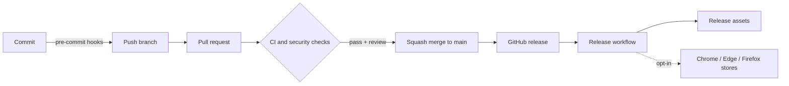

# Architecture

How the pieces of this template fit together. For day-to-day commands, see [development](development.md). For one-time repository settings, see [repository setup](repo-setup.md).

## Overview

A change moves through three layers of checks before it reaches `main`, and a release moves through one more before it reaches the stores.



## Layers

| Layer | What runs | Where |
| --- | --- | --- |
| Local | gitleaks, file hygiene, markdownlint, actionlint, Prettier, ESLint, `tsc`, unit tests, Sweepito scan and cleanup | pre-commit hooks |
| Pull request | `ci` (lint, unit tests on Node.js 22 and 24 plus Windows and macOS, Chromium integration tests, build and `web-ext lint`), dependency review, CodeQL | GitHub Actions |
| Repository | Branch ruleset, secret scanning with push protection, Dependabot alerts and updates | GitHub settings |
| Release | Version check, tests, packages for every browser, optional store uploads | `release.yml` |

## Source layout

```text
src/background/   service worker / event page: badge, install defaults
src/content/      content script: renders the banner
src/popup/        toolbar popup: on/off toggle
src/options/      options page: banner message
src/shared/       api shim, settings storage, i18n, badge logic
manifests/        base.json + chrome.json + firefox.json
scripts/build.mjs esbuild bundling, manifest merge, zipping
```

Each context is bundled into one self-contained script by esbuild (no runtime dependencies, no remote code). The contexts never call each other directly. They share state through `chrome.storage.sync` and react to `storage.onChanged`, which works the same when the background worker is stopped.

The version lives in one place, `package.json`, and the build writes it into each manifest. The release workflow compares it with the release tag.

## Build targets

`scripts/build.mjs` produces `dist/chrome`, `dist/edge`, `dist/chromium` and `dist/firefox`. Chrome-family builds share `manifests/chrome.json`. See [browser support](browser-support.md).

## Workflows

| Workflow | Trigger | Purpose |
| --- | --- | --- |
| `ci.yml` | Pull request, push to `main` | Runs `lint`, `test`, `integration` and `build` in parallel. A final `ci` job gates on all four and is the only check the ruleset requires. |
| `dependency-review.yml` | Pull request | Blocks pull requests that add vulnerable dependencies. |
| `audit.yml` | Weekly, manual, and pull requests that change `package-lock.json` | Runs `npm audit` to catch newly published vulnerabilities. |
| `release.yml` | GitHub release published | Checks the tag matches the version, builds, attaches zips, optionally uploads to stores. |
| `init.yml` | Manual | One-time placeholder replacement in a repo created from the template. Skipped in the template itself. |

CodeQL runs through GitHub's default setup rather than a workflow file.

## Branch governance

The `main` ruleset in `.github/rulesets/main.json` is applied by `scripts/apply_repo_settings.py`. It requires:

- a pull request with a code owner review and resolved conversations, squash merge only
- the `ci` and `dependency-review` checks, with the branch up to date
- CodeQL results
- no deletion and no force push

Repository admins can bypass through a pull request so a solo maintainer is not locked out.

## Template lifecycle

GitHub copies files, not settings. A new repo therefore needs three steps: run **Init** to replace the template owner and name, replace the example extension, and run the settings script to apply protections, environments and the ruleset.
